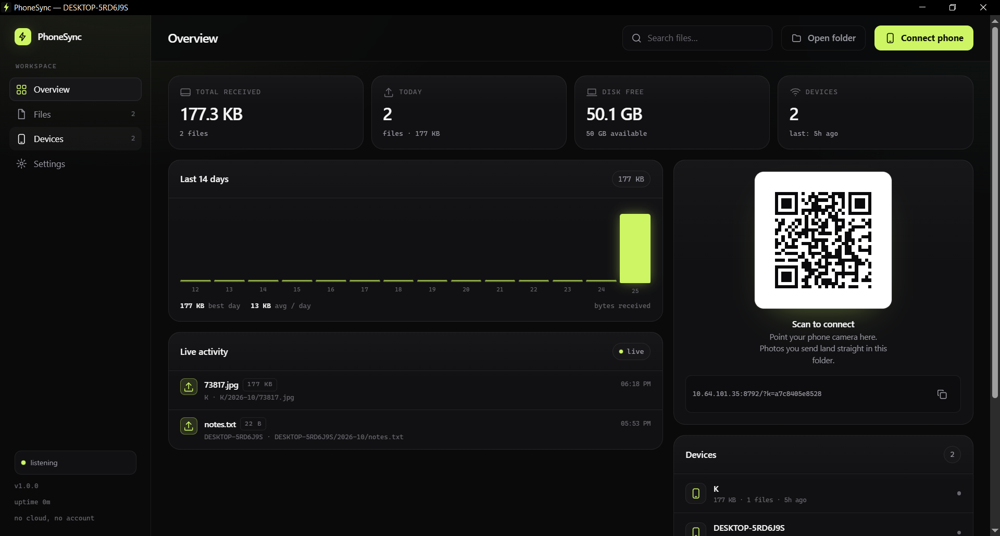
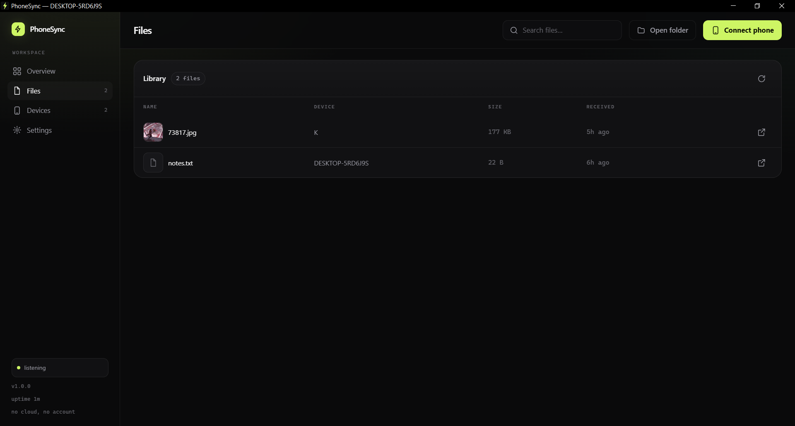
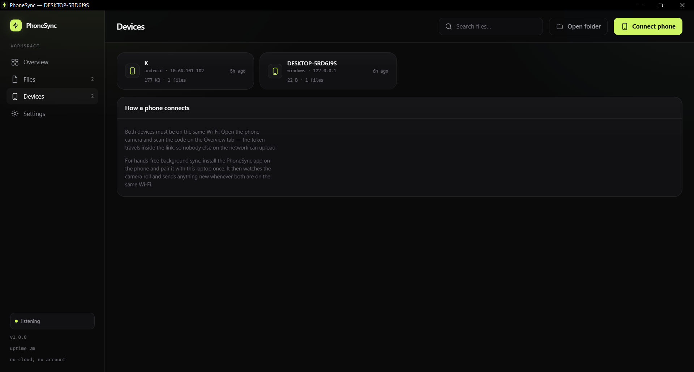
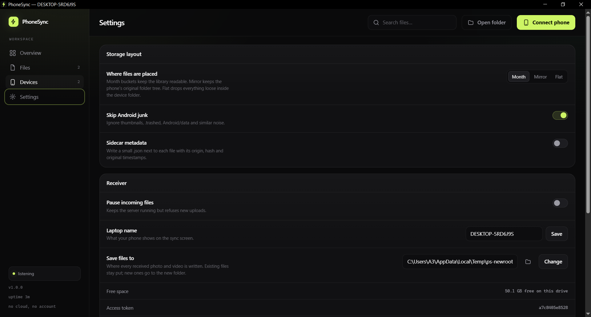

# PhoneSync

**Your phone's photos, videos and files on your Windows laptop — over your own Wi-Fi.**
No cloud, no account, no upload limit.

[**Download for Android**](https://github.com/harshit51290/sync-app/releases/latest/download/PhoneSync-1.0.0.apk) ·
[**Download for Windows**](https://github.com/harshit51290/sync-app/releases/latest/download/phonesync-1.0.0-windows-x64.exe) ·
[Quick start](#quick-start) · [Screenshots](#screenshots)



Two halves, one protocol:

* **Laptop** — a single Rust binary that opens a real desktop window (not a browser tab),
  receives the files, and shows what arrived.
* **Phone** — an Android app that watches the camera roll and pushes new files in the
  background. A zero-install web page is there too, for a borrowed phone or a quick
  one-off send.

```
 phone: PhoneSync.apk  ──┐
                         ├──►  laptop: phonesync app  ──►  %USERPROFILE%\PhoneSync\<device>\<YYYY-MM>\
 phone: browser + QR   ──┘
```

---

## Quick start

On Windows, download `phonesync-1.0.0-windows-x64.exe` from the release and run it —
WebView2 is the only requirement. From source instead:

```powershell
cargo run --release -- app
```

The window opens on the overview: a QR code, the address, and a library that fills as
files arrive. Scan the QR with the phone camera to use the web page, or pair the Android
app with the same code.

Prefer no window — a background receiver with the dashboard in your browser?

```powershell
cargo run --release -- serve --dashboard
```

The binary is self-contained: the dashboard, the phone page, CSS, JS and icons are
embedded at compile time, and the window is WebView2 (already part of Windows 10/11).
Copy `phonesync.exe` anywhere and it still works.

---

## The Android app

[**Download PhoneSync 1.0.0 (APK)**](https://github.com/harshit51290/sync-app/releases/latest/download/PhoneSync-1.0.0.apk)
· Android 10 or newer · 12 MB · signed release build

Copy the APK to the phone and open it. Android will ask permission to install from that
app the first time (*Install unknown apps* → allow for your file manager or browser).

1. Start the laptop app and click **Connect phone**.
2. In the Android app open **Settings**, paste the whole link from the laptop
   (`http://192.168.x.x:8787/?k=…`) into **Address**. The token is taken out of the link
   automatically; **Find laptop** does the same over mDNS when the network allows it.
3. **Test**, then go to the **Sync** tab and press **Sync now**.

**Folders** chooses what is backed up — *Every folder* is the default, or pick the camera
roll, downloads, or specific albums. **Automatic sync** checks every 15 minutes (and after
a reboot); *Wi-Fi only* keeps it off mobile data. A sync you start yourself runs in the
foreground with a progress notification and a **Stop** action.

Files are de-duplicated by SHA-256 on the laptop, so a repeated run — or a reset sync
history — costs nothing.

> The release APK is signed. Keep `android/keystore/` and `android/keystore.properties`
> backed up: Android only accepts an update that carries the same key.

---

## Screenshots

All four pages of the real desktop window, captured from the running app.

| Files — the library | Devices — who has sent what |
| --- | --- |
|  |  |

**Settings** — save folder, organise mode, junk filter, sidecars, pause, laptop name:



---

## The desktop window

`phonesync app` starts the receiver on a background thread and wraps the dashboard in a
native window. Closing the window stops the receiver — nothing is left running.

| Screen | What it holds |
| --- | --- |
| **Overview** | totals, a 14-day intake chart, live activity over SSE, the QR / link |
| **Files** | the library: thumbnails, search, device, size, age, open-in-Explorer |
| **Devices** | every phone that has sent something, with counts and last-seen |
| **Settings** | save folder, organise mode, junk filter, sidecars, pause, laptop name |

### Choosing where files are saved

Settings → **Save files to** takes a typed path, or the folder button next to it, which
opens the native Windows picker. The new folder applies immediately: existing files stay
where they are, new uploads go to the new root, and the change is rejected with a clear
message if an upload is in flight.

---

## The phone web page

`http://<laptop-ip>:8787/?k=<token>` — zero install, works on any phone. Tap the drop zone
or "Choose from phone", watch per-file progress, keep the tab open for a large upload.
Filenames, sizes, duplicates and errors are all shown honestly; nothing retries silently.

---

## CLI

| Command | What it does |
| --- | --- |
| `phonesync app` | Receiver **and** the desktop window — the normal way to run it |
| `phonesync serve` | Receiver only: web UI + upload API + mDNS advertising |
| `phonesync send <paths…>` | Push files/folders to a receiver (`--to`, `--token`, `--watch`) |
| `phonesync discover` | Listen for receivers advertising `_phonesync._tcp` |
| `phonesync info` | Print sync URL, token and QR in the terminal |
| `phonesync service install\|uninstall\|status` | Start-with-Windows scheduled task |
| `phonesync firewall` | Add the inbound firewall rule (needs admin) |

Useful flags:

```text
app     --port 8787  --name "Studio PC"  --root D:\PhoneSync
serve   --port 8787  --bind 0.0.0.0  --name "Studio PC"
        --open              # disable the token (anyone on the Wi-Fi can upload)
        --no-qr             # quiet console
        --dashboard         # open the dashboard in the default browser
        --hide-console      # used by the autostart task

send    --to discover | http://ip:port
        --token <token>     # or env PHONESYNC_TOKEN
        --watch  --state <file>  --only jpg,mp4  --dry-run  --device "Pixel 8"
```

Global: `--root <dir>` (or `PHONESYNC_ROOT`) overrides the storage root.

---

## Where files go

```
<root>/
  .phonesync/
    index.json          # catalogue: name, path, size, sha256, device, timestamps
    sessions/           # in-flight uploads, so a dropped connection resumes
  Pixel 8/2026-10/IMG_20261025_141233.jpg
```

Organise modes (Settings):

* **Month** (default) — `<device>/<YYYY-MM>/<file>`
* **Mirror** — keeps the phone's relative folder (`DCIM/Camera/...`)
* **Flat** — `<device>/<file>`

Collisions never overwrite: `IMG_0001.jpg` becomes `IMG_0001 (2).jpg`. A file whose
SHA-256 already exists is recorded as a duplicate and not written twice.

---

## How the transfer works

1. The phone asks for a session: name, relative path, size, mtime, device.
2. Bytes go up in 8 MiB `PUT` chunks with an `x-offset` header; the server keeps the
   offset and the `.part` file, so an interrupted upload continues where it stopped.
3. On completion the server hashes the file, dedupes, picks a collision-free name,
   moves it into place and appends it to `index.json`.
4. Both UIs get a live event over SSE; the dashboard refreshes itself.

Auth is a shared token (`?k=` in the URL or `x-sync-key` header). Requests from
`127.0.0.1` bypass it so the desktop window and the dashboard need no token. Everything
else on the LAN must present it.

---

## Start with Windows

```powershell
.\phonesync.exe firewall          # one time, needs an admin shell
.\phonesync.exe service install   # scheduled task "PhoneSync", runs at logon
.\phonesync.exe service status
.\phonesync.exe service uninstall
```

The task runs `phonesync serve --hide-console`, so there is no console window and no
window app either — the dashboard stays available at `http://localhost:8787/dashboard`.
Use the Startup folder with `phonesync app` instead if you want the receiver to show a
window whenever you log in.

---

## Build & test

Desktop (Rust 1.75+, edition 2024 — use a current stable toolchain):

```powershell
cargo build --release
cargo test
```

Android (JDK 17 and the Android SDK; AGP 8.x does not accept newer JDKs):

```powershell
cd android
$env:JAVA_HOME = "C:\Android\jdk17\jdk-17.0.20.1+1"
.\gradlew.bat assembleDebug     # debug build, debug-signed
.\gradlew.bat assembleRelease   # release build
```

The debug APK lands in `android\app\build\outputs\apk\debug\app-debug.apk`, the release one
in `android\app\build\outputs\apk\release\app-release.apk`.

Release signing is read from `android/keystore.properties` (gitignored):

```properties
storeFile=keystore/phonesync-release.jks
storePassword=…
keyAlias=phonesync
keyPassword=…
```

Without that file `assembleRelease` falls back to debug signing, so a fresh clone still
produces an installable APK.

`android/local.properties` points at the SDK (`sdk.dir=C:\Android\sdk`) and is
machine-specific, so it is gitignored too.

Dependencies: axum, tokio, reqwest (rustls), mdns-sd, notify, qrcode, sha2, tower-http,
wry + tao (desktop window), rfd (folder picker).

```
src/
  main.rs        CLI surface
  config.rs      settings + token, %APPDATA%\phonesync\config.json
  window.rs      native window, WebView2, folder-picker IPC
  server/
    mod.rs       state, listener, mDNS, banner
    api.rs       every route (info, stats, files, sessions, events, actions)
    middleware.rs token gate
  store.rs       index, placement, dedupe, stats
  client.rs      send + watch
  discover.rs    mDNS browse
  service.rs     schtasks + netsh
  ui/            embedded dashboard, phone page, css, js, icons
android/         Kotlin app (Gradle project, builds an APK)
docs/screenshots/  the images in this README
```

### Adding a feature

* New endpoint → add a handler and a route in `src/server/api.rs`.
* New screen → drop a `.html` in `src/ui/`, register it in `src/ui.rs` and add a nav
  item; the auth middleware and asset router pick it up automatically.
* New shared UI helper → `src/ui/core.js` (`PS` object: `api`, `icon`, `bytes`,
  `ago`, `toast`, `hydrateIcons`).
* New setting → `Settings` in `src/config.rs`, the PATCH arm in `api.rs`, and the row in
  `dashboard.html` + `dash.js`.

---

## Troubleshooting

**Phone can't reach the laptop.** Check both devices are on the same non-guest SSID,
then `phonesync firewall` from an admin shell. Corporate/AP-isolated Wi-Fi blocks
device-to-device traffic entirely.

**QR scanned, but the page is blank.** The token in the URL is required. Re-copy the
link from the window's "Connect phone" panel.

**`discover` finds nothing.** mDNS is often filtered on Windows networks; type the
address (`http://<laptop-ip>:8787`) and token into the app by hand instead.

**Upload stalled at some percent.** The session keeps its offset — re-select the same
file and it resumes rather than starting over.

**The window won't start.** It needs WebView2; Windows 11 and up-to-date Windows 10 ship
it. `phonesync serve --dashboard` works without it.

**Logs.** `set PHONESYNC_LOG=phonesync=debug` before starting the server.

---

## License

MIT — see [LICENSE](LICENSE). No telemetry, no external services; every byte stays on
your LAN.
